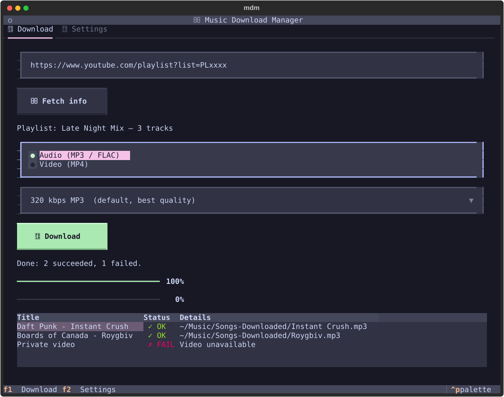
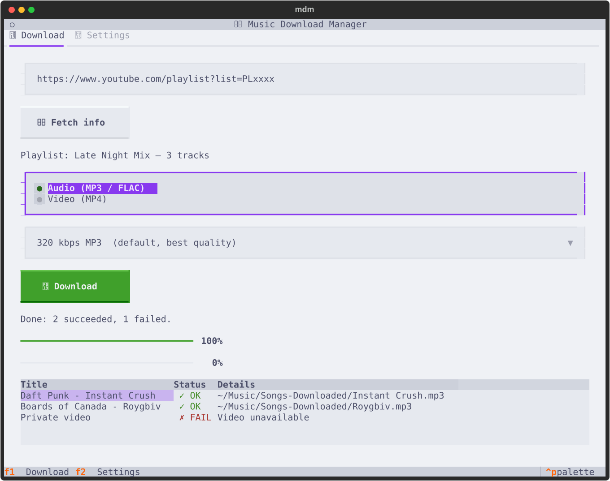
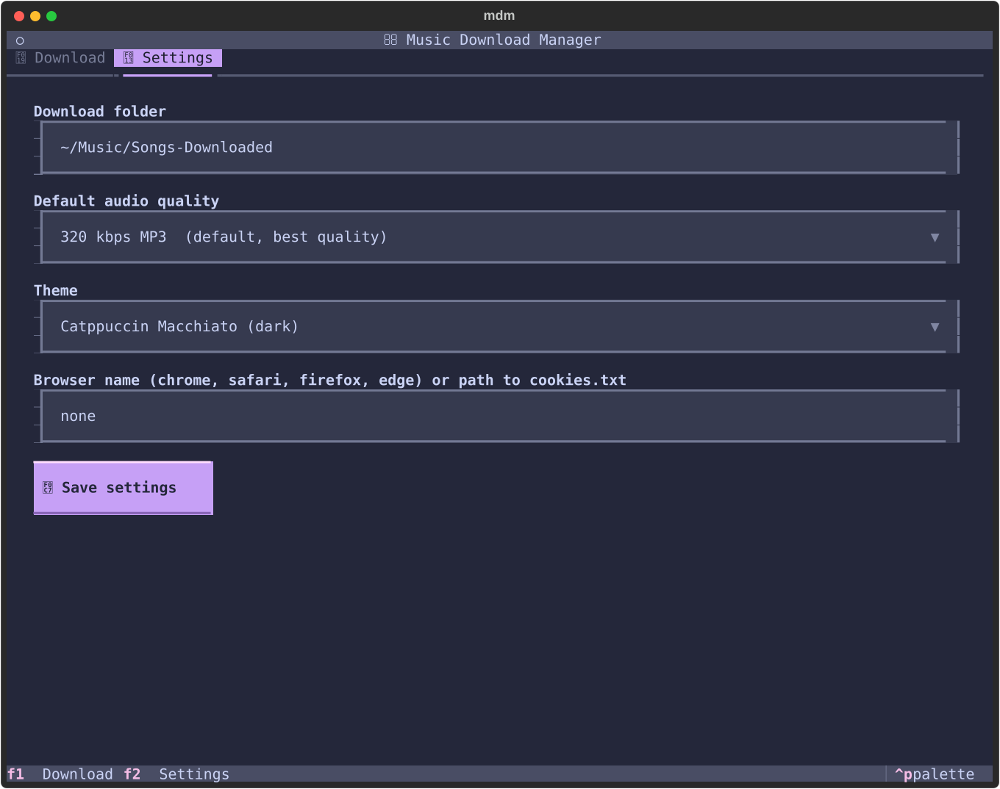
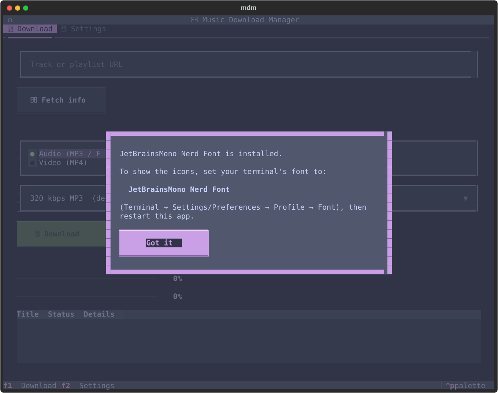

<h1 align="center">Music Download Manager</h1>

<p align="center">
  A full-screen terminal app for downloading audio and video from YouTube,<br>
  with Catppuccin themes that follow your operating system.
</p>

<p align="center">
  
  
  
</p>

<p align="center">
  
</p>

## Features

- **Tracks and playlists.** A failed track never stops the rest of a playlist.
- **Audio:** MP3 at 320, 192 or 128 kbps, or lossless FLAC, with metadata and cover art embedded.
- **Video:** MP4 at 1080p, 720p, 480p or 360p.
- **Live progress.** Overall and per-track bars, plus a results table showing OK or FAIL for each track.
- **Resilient.** Failed downloads are retried automatically after 2, 4 and 8 seconds.
- **Catppuccin themes.** Latte, Frappe, Macchiato and Mocha, or Auto to follow the OS light and dark setting.
- **Nerd Font icons.** The font is installed for you if it is missing.
- **Cookie support.** Use a browser session or a `cookies.txt` file to get past YouTube restrictions.
- **Persistent settings.** Your choices are saved between sessions.

## Screenshots

| Light: Catppuccin Latte | Dark: Catppuccin Mocha |
|:---:|:---:|
|  |  |

| Settings: Macchiato | First-run font notice: Frappe |
|:---:|:---:|
|  |  |

## Requirements

- Python 3.10 or newer
- [ffmpeg](https://ffmpeg.org/) on your `PATH`
  - macOS: `brew install ffmpeg`
  - Linux: `sudo apt install ffmpeg`

## Installation

```bash
git clone https://github.com/spacecodee/music-download-manager.git
cd music-download-manager
python3 -m venv .venv
source .venv/bin/activate
pip install -r requirements.txt
```

## Usage

```bash
python mdm.py
```

| Key | Action |
|-----|--------|
| `F1` | Download tab |
| `F2` | Settings tab |
| `Ctrl+P` | Command palette |
| `Ctrl+Q` | Quit (cancels a download in progress) |

**Downloading**

1. Paste a `youtube.com` or `youtu.be` URL and choose **Fetch info**.
2. Pick Audio or Video and a quality.
3. Choose **Download**. Progress and results appear below.

## Themes

Pick a theme in **Settings**. The choice is saved in the config file.

| Setting | Appearance |
|---------|------------|
| Auto (default) | Mocha when the OS is dark, Latte when it is light. Re-checked every 3 seconds. |
| Catppuccin Latte | Light |
| Catppuccin Frappe | Dark |
| Catppuccin Macchiato | Dark |
| Catppuccin Mocha | Dark |

OS detection uses `defaults` on macOS and `gsettings` on GNOME. Where the OS setting cannot be read, Auto uses Mocha.

## Nerd Font

Icons use [JetBrainsMono Nerd Font](https://www.nerdfonts.com/). On launch, the app looks for a Nerd Font in your system and user font folders.

- If none is found, it downloads JetBrainsMono Nerd Font into `~/Library/Fonts` (macOS) or `~/.local/share/fonts` (Linux).
- A one-time notice then asks you to select that font in your terminal's profile settings and restart the app.
- Until the font is installed and selected, the app shows plain text labels without icons.
- On Windows, install the font manually.

## Configuration

Stored in `~/.config/mdm/config.json`:

| Key | Default | Description |
|-----|---------|-------------|
| `download_dir` | `~/Music/Songs-Downloaded` | Output folder, created if missing. |
| `default_quality` | `320` | Preselected audio quality: `320`, `192`, `128` or `flac`. |
| `theme` | `auto` | `auto`, `catppuccin-latte`, `catppuccin-frappe`, `catppuccin-macchiato` or `catppuccin-mocha`. |
| `browser_cookies` | `none` | `none`, a browser name (`chrome`, `safari`, `firefox`, `edge`) or a path to a `cookies.txt` file. |
| `font_notice_shown` | `false` | Set to `true` once the font notice has been shown. |

### YouTube cookies

If YouTube blocks a download (bot check, age restriction), set a logged-in browser or a `cookies.txt` path in Settings. A value ending in `.txt`, or containing `/` or `\`, is treated as a file. Anything else is treated as a browser name.

## Project structure

```
mdm.py          Entry point
tui.py          Textual interface: tabs, themes, progress, results
fonts.py        Nerd Font detection and installation
downloader.py   yt-dlp logic: info, audio, video, playlists, retries
config.py       JSON configuration load and save
tests/          pytest suite
docs/           Design specs, plans and screenshots
```

## Development

```bash
pytest
```

## Legal notice

Download only content you own or have permission to download, and respect YouTube's terms of service and the laws of your country.

## License

Released under the [MIT License](LICENSE).
